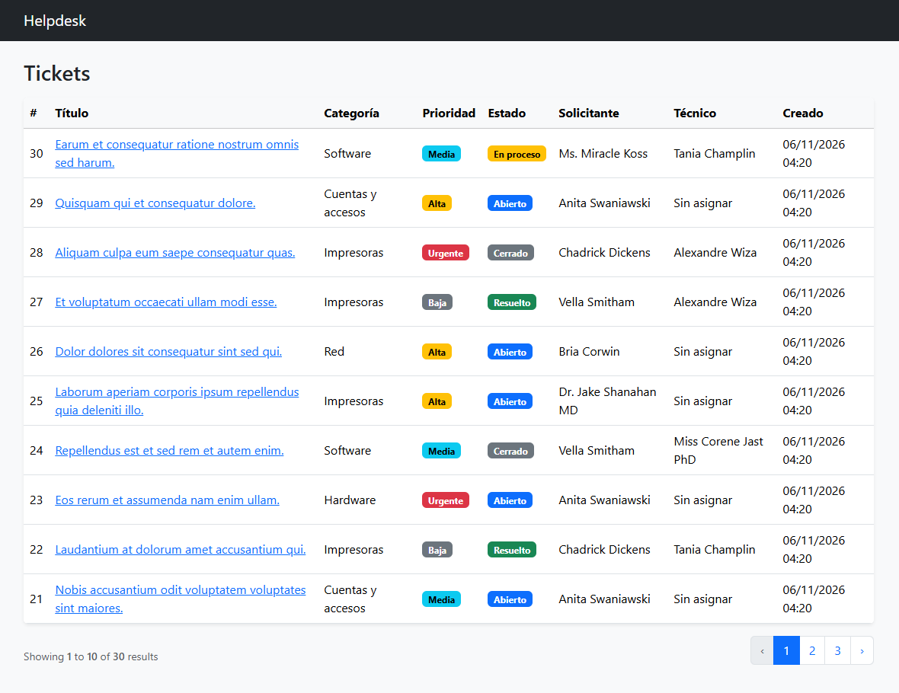

# Helpdesk Laravel

Sistema de tickets e incidencias para soporte técnico interno, construido con Laravel y SQL Server. Proyecto de práctica enfocado en CRUD, modelado relacional y API REST.

## Capturas



## Tecnologías

- PHP 8.4 y Laravel 12
- SQL Server 2022 (en contenedor Docker)
- Git y GitHub
- React (fase posterior, para el panel que consume la API)

## Estado del proyecto

- [x] Fase 0: entorno y conexión a SQL Server
- [x] Fase 1: base de datos y modelos
- [ ] Fase 2: CRUD de tickets
  - [x] Listado y detalle
  - [x] Crear y editar con validación
  - [ ] Flujo de estados, asignación y comentarios
- [ ] Fase 3: autenticación y roles
- [ ] Fase 4: reportes con SQL Server
- [ ] Fase 5: API REST
- [ ] Fase 6: panel en React

## Modelo de datos

| Tabla | Descripción |
|---|---|
| `users` | Usuarios con un campo `rol` (usuario, técnico, administrador) |
| `categorias` | Clasificación de los tickets |
| `tickets` | Incidencias con estado, prioridad, solicitante y técnico asignado |
| `comentarios` | Seguimiento de cada ticket |
| `historial_estados` | Registro de cambios de estado |

## Instalación

Requisitos: PHP 8.2+, Composer, Node.js, Docker, ODBC Driver 18 for SQL Server y las extensiones `sqlsrv` y `pdo_sqlsrv` de PHP.

1. Clonar el repositorio e instalar dependencias:
   ```
   git clone https://github.com/TU-USUARIO/helpdesk-laravel.git
   cd helpdesk-laravel
   composer install
   ```
2. Levantar SQL Server:
   ```
   docker run -e "ACCEPT_EULA=Y" -e "MSSQL_SA_PASSWORD=<tu-contraseña>" -p 1433:1433 --name sqlserver -v sqlserver_data:/var/opt/mssql -d mcr.microsoft.com/mssql/server:2022-latest
   ```
3. Crear la base de datos `helpdesk` desde cualquier cliente SQL.
4. Configurar el entorno:
   ```
   copy .env.example .env
   php artisan key:generate
   ```
   Editar `.env` con `DB_CONNECTION=sqlsrv`, los datos de conexión y `DB_TRUST_SERVER_CERTIFICATE=true` (solo en desarrollo).
5. Migrar y ejecutar:
   ```
   php artisan migrate
   php artisan serve
   ```

## Decisiones técnicas

- **Un técnico por ticket** al inicio, para simplificar. Se puede ampliar a varios con una tabla intermedia.
- **Sin borrado en cascada hacia `users`**: SQL Server rechaza esquemas con múltiples rutas de cascada hacia la misma tabla.
- **`trust_server_certificate`**: el ODBC Driver 18 exige cifrado y el contenedor usa un certificado autofirmado; se confía en él solo en desarrollo local.

## Autor

Ernesto